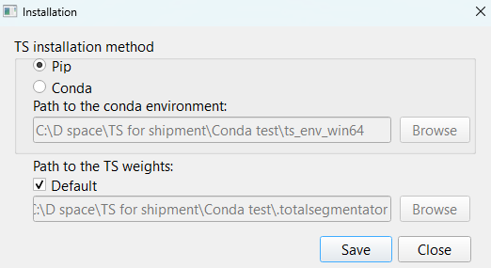
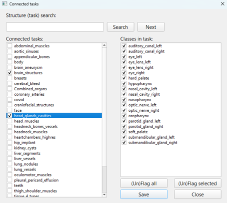
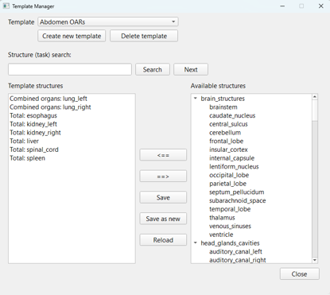
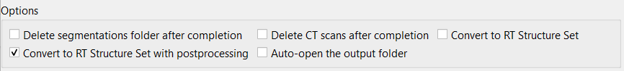
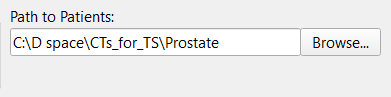
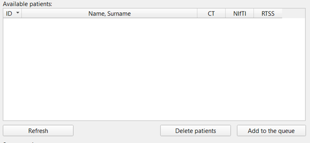
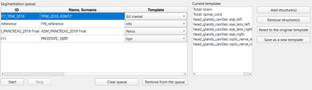

# TotalSegmentator UI — User Guide

This guide explains how to configure **TotalSegmentator UI**, create segmentation templates, process DICOM CT studies, and export the results as DICOM RT Structure Sets (RTSTRUCT). It assumes that the application and TotalSegmentator have already been installed.

> **Scope:** The UI supports CT segmentation only. Although TotalSegmentator also provides MRI segmentation tasks, they are not available through this interface.

## 1. Initial configuration

### 1.1. Installation settings

Open **Settings → Installation** and configure the following:

- **TS installation method:** Select **Pip** if TotalSegmentator was installed through Python and pip. Select **Conda** if it was installed in a Conda environment (typically for an offline workstation). For **Conda**, specify the path to the environment.
- **Path to the TS weights:** Leave **Default** selected if the model weights are stored in TotalSegmentator's standard `.totalsegmentator` directory (typically `C:\Users\<username>\.totalsegmentator` on Windows). Otherwise, clear **Default** and select the directory containing the model weights.

Click **Save** to apply the settings.



### 1.2. Select available segmentation tasks

Open **Settings → Connected tasks**. This window lists CT segmentation tasks (groups of structures) and their individual classes (structures).

Select the tasks and structures that you intend to use. The selected structures become available in **Template Manager**. You can also select tasks that require a license; however, a valid license will be required to run those tasks successfully (see [Licensing](#7-licensing)).

Click **Save** when finished.



## 2. Create segmentation templates

Open **Settings → Template Manager** to create reusable sets of structures for segmentation. Locate the required structures and add them to a template.

The main controls are:

| Control | Function |
| --- | --- |
| **Create new template** | Create a template and enter its name. |
| **Save** | Save changes to the selected template. |
| **Save as new** | Save the current structure selection as a separate template. |
| **Reload** | Discard unsaved changes and restore the last saved version of the selected template. |
| **Delete template** | Delete the selected template. |



## 3. Configure processing options

The **Options** section of the main window controls output conversion, file cleanup, and folder handling.

| Option | Description |
| --- | --- |
| **Convert to RT Structure Set** | Convert the generated segmentations directly into a DICOM RT Structure Set. |
| **Convert to RT Structure Set with postprocessing** | Convert to an RT Structure Set with additional contour processing: increased contour resolution, smoothing, and a 0.5 mm isotropic expansion. |
| **Delete segmentations folder after completion** | Delete the patient's `segmentations` folder containing the generated NIfTI files. |
| **Delete CT scans after completion** | Delete the CT series used for segmentation. |
| **Auto-open the output folder** | Open the patient's output folder after processing is completed. |



**Important:** The two deletion options are intended for workflows in which only the final RT Structure Set needs to be retained for import into a treatment planning system (TPS). Enable them only if the original CT data and NIfTI segmentations are no longer needed in these folders.

## 4. Select the patient directory

In **Path to Patients**, click **Browse** and select the *parent directory* containing the individual patient folders. Each patient must have a separate subfolder containing their DICOM files, for example:

```text
Patients/
├── Patient_001/
│   └── [DICOM files]
├── Patient_002/
│   └── [DICOM files]
└── Patient_003/
    └── [DICOM files]
```

Do not select a folder containing DICOM files directly at its root, or a parent folder without patient subfolders containing DICOM data. These layouts are not recognized as valid patient directories. If no valid patient folders are found, the application restores the last saved directory path.



## 5. Add patients to the segmentation queue

In **Available patients**, click **Refresh** to scan the selected directory. The application checks each patient folder for CT data, NIfTI segmentations, and an RT Structure Set. Scanning a large number of patients may take some time.

**Note:** RT Structure Set detection uses a specific expected filename. An RTSTRUCT exported from a TPS under a different name may not be recognized in this list.

Select the patients to process and click **Add to the queue**. Use **Ctrl** to select individual patients or **Shift** to select a range. After clicking **Add to the queue** selected patients appear in the **Segmentation queue** below.



## 6. Assign templates and start segmentation

In **Segmentation queue**:

1. Choose a template from the dropdown list for each patient. You can select multiple patients with **Ctrl** and assign the same template to them.
2. Reorder patients in the queue using drag and drop, if required.
3. Select a patient to review the structures listed in **Current template**. You can add or remove structures for this individual segmentation without changing the original template, or save the modified selection as a new template.
4. Confirm the selected patients, templates, and processing options, then click **Start**.



### Output locations

- **NIfTI segmentations:** Saved in the `segmentations` subfolder of the corresponding patient directory, unless the cleanup option is enabled.
- **DICOM RT Structure Set:** Saved in the same directory as the patient's CT series when RTSTRUCT conversion is enabled.

### First-run model downloads

TotalSegmentator automatically downloads required model weights when they are not already available and the workstation has internet access. Consequently, the first run of a template that uses new tasks may take longer. **Offline workstations must have the required model weights available locally in advance.**

## 7. Licensing

Some TotalSegmentator tasks require a license. The list of licensed tasks and the license request procedure are available in the [TotalSegmentator repository](https://github.com/wasserth/TotalSegmentator).

A license can be requested free of charge using an institutional or organizational email address rather than a personal email service. The license key is sent automatically.

To configure the license, open **Settings → License** in the main window and enter the key.

If a task cannot be processed—for example, because its license is missing—the UI skips that task and continues processing the remaining tasks. Successful segmentations can still be converted to an RT Structure Set. **Review the resulting structure set to confirm that all required structures are present.**
